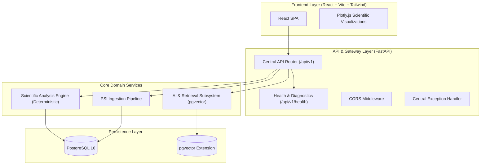

# FlameLens — Architecture Specification

## 1. System Overview

**FlameLens** is an intelligent scientific research platform built for NASA's *Flame in Freefall* challenge. It enables researchers to explore, analyze, compare, and query microgravity combustion experiments sourced from the NASA Physical Sciences Informatics (PSI) repository.

The platform follows a **modular monolithic architecture** designed for high cohesion, low coupling, deterministic scientific computation, and traceable AI-assisted retrieval.



---

## 2. Directory Layout & Boundaries

```text
backend/
├── app/
│   ├── main.py              # FastAPI application instance & lifespan
│   ├── config.py            # Pydantic BaseSettings & env resolution
│   ├── dependencies.py      # Dependency injection providers
│   ├── api/                 # HTTP routers & route controllers
│   │   ├── router.py        # Central v1 router registry
│   │   └── v1/              # Versioned API endpoints
│   │       └── health.py    # System health & telemetry
│   ├── core/                # Cross-cutting foundational modules
│   │   ├── exceptions.py    # Custom domain exceptions & handlers
│   │   └── logging.py       # Structured application logging
│   ├── models/              # SQLAlchemy 2.x ORM models
│   ├── schemas/             # Pydantic request/response schemas
│   ├── services/            # Business logic orchestration
│   ├── scientific/          # Deterministic units, conversions, statistics
│   ├── data_pipeline/       # NASA PSI ingestion, scrapers, normalization
│   └── ai/                  # Embeddings, chunking, LLM orchestration
└── tests/                   # Pytest test suites
```

---

## 3. Core Architectural Rules

1. **Modular Monolith**: All components execute within a unified process with explicit module boundaries.
2. **Separation of Concerns**:
   - Routes handle HTTP parsing, status codes, and input validation.
   - Services coordinate workflows and business logic.
   - Scientific modules perform pure deterministic calculations (never LLM-generated math).
   - Data models define relational schema; Pydantic schemas define validation and contracts.
3. **Traceability**: All analytical conclusions, measurements, and AI responses must maintain explicit provenance linking to source NASA PSI investigations or datasets.
